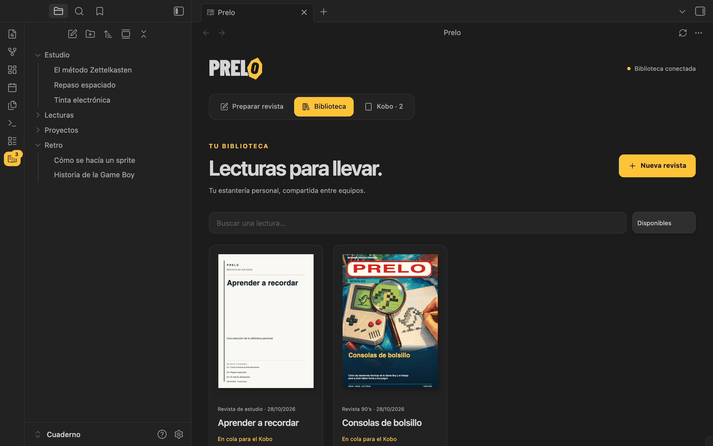
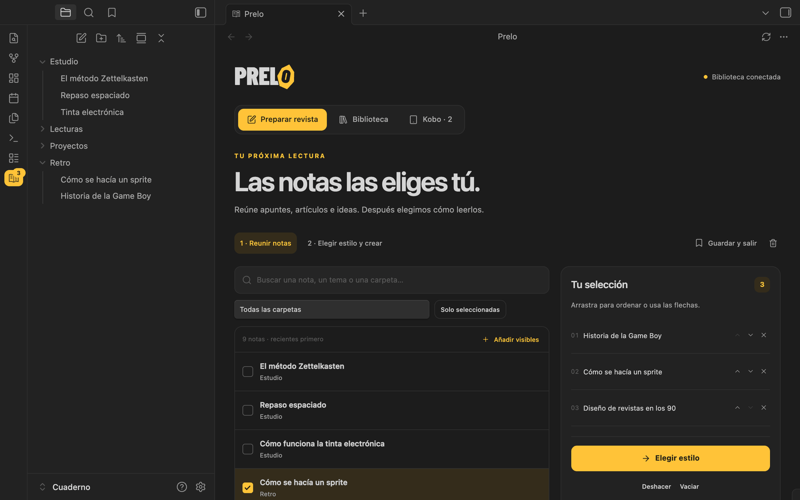
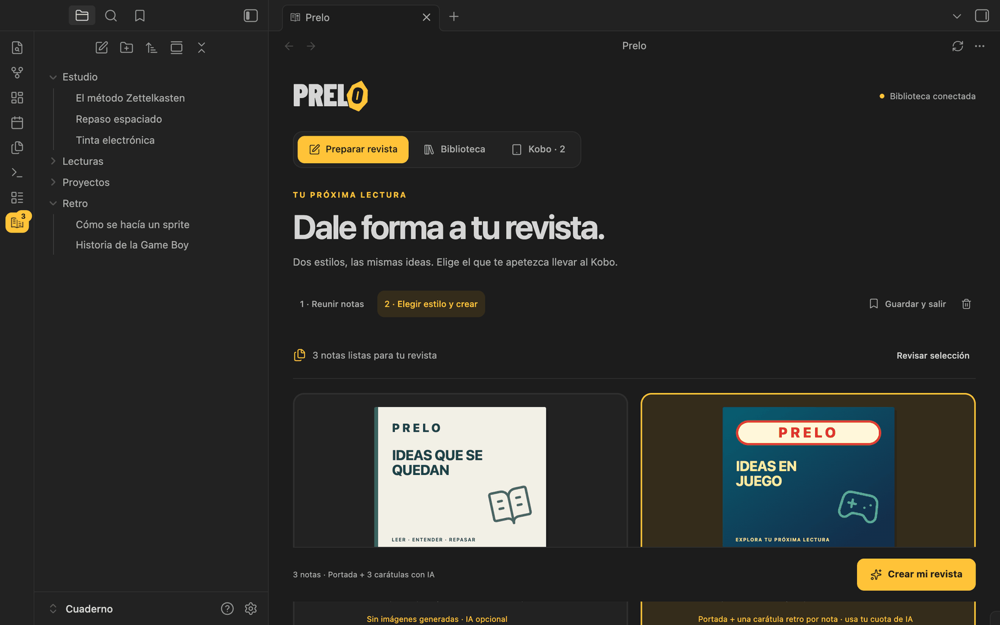
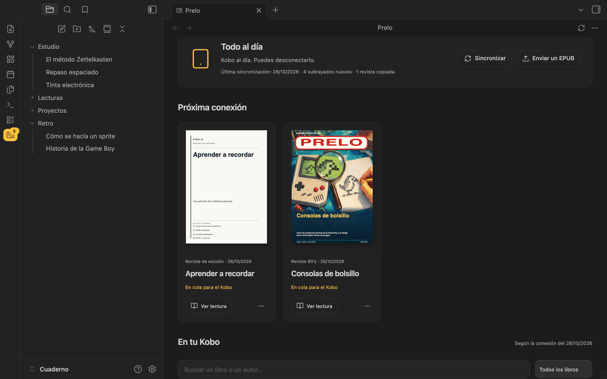
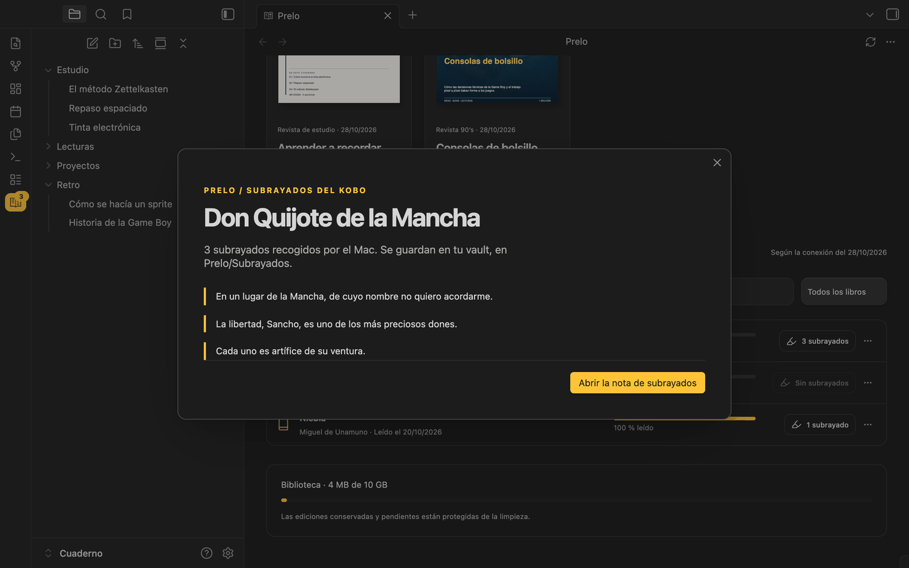
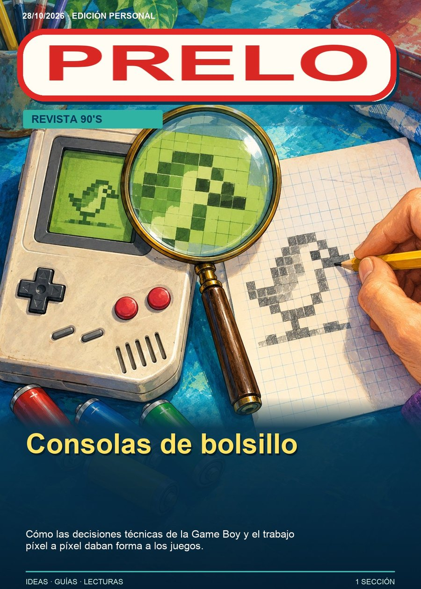

   
  
  <h1><code>./PRELO.sh</code></h1>

**Elige qué leer. Conecta el cable. Vuelve con subrayados.**
  

  
  
   
  
  
  
   
  
  
  
    

[Instalación](docs/instalacion.md) ·
[Privacidad](docs/privacidad.md) ·
[Revista 90's](docs/revista-90s.md) ·
[Desarrollo](docs/desarrollo.md) ·
[Historial](CHANGELOG.md)

  <code style="color:#737373;">// prelo: la prensa donde tus notas se convierten en lectura //</code>

    

  
   
  <b>La biblioteca.</b> Cada revista que preparas queda en el Mac, compartida entre tus equipos, lista para viajar al Kobo en la próxima conexión.

---

## // 00_ LA_IDEA

Prelo convierte una selección de notas de Obsidian en una publicación EPUB para Kobo. Preparas la lectura, la dejas en la cola y, cuando conectas el lector por USB al Mac, el conector recoge las anotaciones y entrega las publicaciones pendientes. Los subrayados vuelven al vault con enlaces a sus notas de origen.

La sincronización con el Kobo es por USB. El cable forma parte del ritmo del producto: preparar una selección y reservar un momento para llevarla y recoger lo leído.

> _note: las capturas usan un vault de demostración con notas inventadas y un Kobo simulado; ningún dato procede de un vault real._

---

## // 01_ EL_RECORRIDO

**1. Reúne las notas.** Pulsa el icono de **revista** de Prelo en Obsidian. Busca por título o carpeta, marca las notas y ordénalas en tu selección. También puedes añadirlas desde el explorador con clic derecho → **Añadir a Prelo**.

  

**2. Elige el estilo.** **Revista de estudio** es sobria y no usa IA por defecto. **Revista 90's** añade portada y una carátula retro por nota con Codex. Después decides la redacción, los apoyos para estudiar y si va a la cola del Kobo.

  

**3. Conecta el Kobo al Mac.** Acepta **Conectar** en su pantalla. El conector importa los subrayados, copia la cola, verifica los archivos y expulsa el lector. Desde la pestaña **Kobo** ves qué hay pendiente y qué llevas leído, y puedes pedir cambios desde cualquier equipo.

  

**4. Vuelve con subrayados.** Lee sin conexión. En la siguiente conexión USB, las citas regresan al vault, agrupadas por lectura y enlazadas a sus notas de origen. Importar dos veces no duplica citas.

  

---

## // 02_ REVISTA_90'S

Una portada general y una carátula por nota, ilustradas para el contenido de cada edición con la generación de imágenes de Codex. La plantilla pone la cabecera, los marcos y los títulos; las ilustraciones no salen de una biblioteca genérica.

<table align="center">
  <tr>
    <td align="center" width="50%">
      
       
      <b>Portada.</b> «Consolas de bolsillo», a partir de dos notas de prueba.
    </td>
    <td align="center" width="50%">
      
       
      <b>Carátula de la nota.</b> Cada nota abre con su propia ilustración.
    </td>
  </tr>
</table>

Generar una Revista 90's consume la cuota de tu Codex: con N notas se crean N + 1 imágenes. [Dirección visual y proceso](docs/revista-90s.md).

---

## // 03_ QUÉ_INCLUYE

| PIEZA | QUÉ ES |
| :--- | :--- |
| **Vista en Obsidian** | Selección, biblioteca, borradores y cola en una pestaña propia. Los borradores guardan también la redacción, los apoyos y las preferencias de IA y envío. |
| **EPUB 3** | Portada, índice, imágenes locales, tablas y código. Ediciones independientes e identidades estables para conservar la procedencia. |
| **Dos estilos** | **Revista de estudio**, sin IA por defecto. **Revista 90's**, con portada general y una carátula retro por nota mediante Codex. |
| **Redacción** | Notas originales (por defecto), revista narrativa, explicación sencilla, paso a paso o repaso rápido. El modo original conserva el cuerpo; los demás adaptan solo el EPUB, se identifican como adaptación con IA y no modifican el vault. Repaso rápido condensa y omite detalles. |
| **Apoyos con IA** | Esquemas y tablas, preguntas con respuestas o un kit completo, en Markdown legible sin conexión. Compatibles con ambos estilos. |
| **Instrucciones extra** | Pide, por ejemplo, que cada tema vaya seguido de su examen resuelto. Activan IA aunque el texto se conserve original. Puedes bloquear el orden exacto de la selección; ese bloqueo prevalece sobre cualquier reorganización. |
| **Subrayados** | Importaciones repetibles sin duplicar citas; las actualizaciones conservan tus comentarios anteriores. |
| **Biblioteca** | Límite de almacenamiento configurable y ediciones protegidas. **Eliminar EPUB** retira el archivo y cancela su envío, conservando subrayados e historial; las copias del Kobo o del vault se mantienen. |
| **Actualizaciones** | Avisos de nuevas versiones y actualización del plugin desde Obsidian, con verificación SHA-256. Cada equipo actualiza su plugin por separado; el servicio del Mac, con su paquete. |
| **Servicio personal** | Acceso autenticado y datos propios. No depende de un servicio alojado por el autor. |

---

## // 04_ INSTALAR

**Distribución beta.** Consulta las versiones publicadas y sus paquetes de Mac/plugin en [Releases](https://github.com/samuhlo/prelo-ob/releases). El estado de las comprobaciones de cada versión está en [Aceptación de la beta](docs/validacion-publica.md).

Prelo tiene dos piezas: un servicio en el Mac que genera las publicaciones y gestiona el Kobo, y un plugin de Obsidian que puede usarse desde Mac, Windows o Linux.

### En el Mac al que conectarás el Kobo

1. Ten Obsidian y un vault abierto al menos una vez. Instala [uv](https://docs.astral.sh/uv/getting-started/installation/) y [Docker Desktop](https://docs.docker.com/desktop/setup/install/mac-install/), o usa tu Colima ya configurado e iniciado.
2. Descarga y descomprime el paquete **prelo-macos de la versión elegida** desde la release. Cierra Obsidian antes de instalar.
3. Abre **Instalar Prelo.command**. Indica la carpeta del vault y elige si quieres usar tu Codex CLI para IA; puedes empezar sin IA.
4. Abre Obsidian. En **Ajustes → Complementos de la comunidad**, activa Prelo si es necesario.

El paquete incluye el plugin compilado: no necesitas Node ni compilar el proyecto. El instalador genera una credencial privada, prepara el servicio, configura el conector USB para tu vault y guarda una copia de la configuración anterior al actualizar.

[Guía de instalación, requisitos, actualizaciones y desinstalación](docs/instalacion.md).

### Plugin en otros ordenadores

Puedes instalarlo con [BRAT](https://github.com/TfTHacker/obsidian42-brat): añade `samuhlo/prelo-ob` como plugin beta y selecciona la versión publicada que vayas a usar. También puedes descomprimir el ZIP del plugin y copiar `margen` a `.obsidian/plugins/` de tu vault.

Después importa el archivo privado de conexión de **tu propio servidor** desde **Prelo: Conectar con el servidor**. Para usarlo desde otro equipo, el Mac necesita una dirección accesible por HTTPS en tu red privada; `127.0.0.1` solo sirve en el propio Mac. [Conectar otro ordenador](docs/instalacion.md#conectar-otro-ordenador).

Instalar únicamente el plugin requiere que ya exista un servicio Prelo. La publicación en GitHub permite instalarlo con BRAT o manualmente; aún no está en el catálogo oficial de complementos de Obsidian.

---

## // 05_ COMPATIBILIDAD

| COMPONENTE | COMPATIBILIDAD DE ESTA BETA |
| :--- | :--- |
| Servicio y automatización USB | macOS, con Docker y uv; sesión del usuario iniciada |
| Plugin de Obsidian | Obsidian de escritorio 1.8 o posterior, en macOS, Windows y Linux |
| Kobo | Circuito manual comprobado con Kobo Libra Colour; otros modelos y firmwares requieren prueba |
| Móvil | No incluido |

El conector USB automático tiene pruebas con dispositivos simulados; su validación física específica sigue pendiente. Publicamos esta versión como **beta**, con [límites y comprobaciones documentados](docs/validacion-publica.md).

El Mac debe permanecer encendido, con su sesión iniciada y Docker disponible. Obsidian puede estar cerrado durante la sincronización USB. Prelo escribe los subrayados en el vault del Mac; si utilizas otros equipos, la sincronización de esos Markdown depende de la herramienta que ya uses para tu vault.

---

## // 06_ IA_Y_DATOS

Puedes preparar revistas de estudio sin IA. Para la organización y las ilustraciones con Codex, cada persona utiliza su propia instalación oficial de Codex CLI y su propia cuenta con acceso a Codex. Prelo no distribuye ni comparte una cuenta de ChatGPT. [Autenticación de Codex](https://learn.chatgpt.com/docs/auth).

Al activar IA, las notas seleccionadas se envían al proveedor elegido y consumen sus límites o cuota. Sin IA, el contenido se procesa en tu servicio. No hay telemetría añadida por Prelo. [Datos, permisos y credenciales](docs/privacidad.md).

---

## // 07_ DESARROLLO

Código del plugin en `plugin/`, servicio Python en `server/` e instaladores en `scripts/`. El identificador técnico `margen` se conserva para actualizar las instalaciones anteriores sin duplicar el plugin ni romper anotaciones.

[Guía de desarrollo y releases](docs/desarrollo.md) · [Dirección de producto](docs/producto.md) · [Estilo Revista 90's](docs/revista-90s.md) · [Historial](CHANGELOG.md)

Licencia [MIT](LICENSE). La piedra del logo es la misma de [Anaco](https://github.com/samuhlo/anaco-ob); el icono lateral conserva la revista. [Avisos de terceros](THIRD_PARTY_NOTICES.md).
